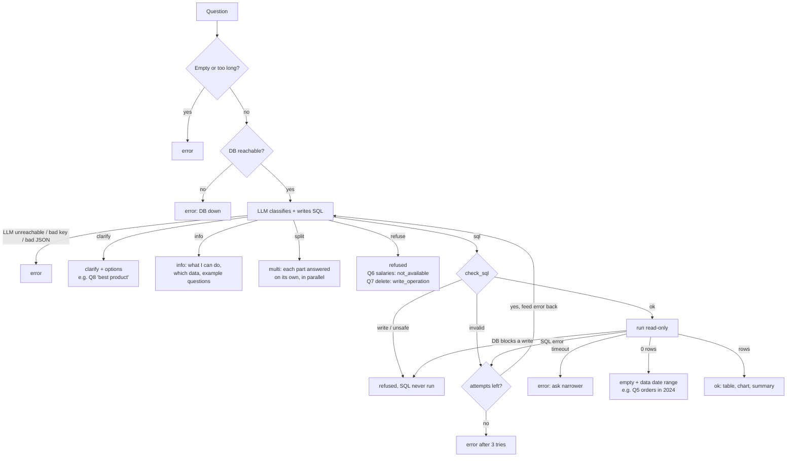
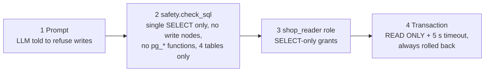

# How a question is answered

This covers what happens between the browser sending `POST /api/ask` and the page rendering the answer. The code is in `backend/app/`: `main.py` → `pipeline.py`, which calls `llm.py`, `prompt.py`, `safety.py`, `db.py` and `formatting.py`.

## 1. Sequence (happy path, plus where each failure leaves the flow)

```mermaid
sequenceDiagram
    autonumber
    actor Owner as Shop owner
    participant UI as Frontend (React)
    participant API as FastAPI main.py
    participant P as pipeline.py
    participant DB as PostgreSQL (shop_reader)
    participant LLM as OpenAI (gpt-4.1-mini)

    Owner->>UI: types / clicks a question
    UI->>API: POST /api/ask {question, history[≤6 turns of question+sql]}
    Note over API: Bad body → 400 JSON error<br/>Any crash → 500 JSON error (never a blank page)
    API->>P: ask(question, history)
    Note over P: Empty or > 500 chars → status "error"
    P->>DB: ping (2 s timeout)
    Note over P: DB down → "error" in ~2 s, no LLM call
    P->>DB: data profile (counts, date range) — cached after first call
    P->>P: build_messages: system prompt (schema.sql, glossary, data profile, today)<br/>+ 6 few-shot examples + history + question

    loop up to 3 attempts (1 + MAX_RETRIES=2)
        P->>LLM: chat_json (JSON mode, temperature 0)
        LLM-->>P: {kind, sql, steps, interpretation, columns, chart, suggestions...}
        alt kind = clarify
            P-->>API: status "clarify" + message + 2–4 options
        else kind = refuse
            P-->>API: status "refused" (write_operation | not_available)
        else kind = info (general question: "bạn làm được gì?", "có những bảng nào?")
            P-->>API: status "info" + message + example questions + table list (from schema_info.py, not the LLM)
        else kind = split (2–3 independent asks)
            P->>P: run the whole pipeline for each part, in parallel threads
            P-->>API: status "multi" + parts[] (each part is a full answer)
        else kind = sql
            P->>P: safety.check_sql (sqlglot)
            alt write / pg_* function / other schema (UnsafeSQL)
                P-->>API: status "refused" — SQL is never sent to the DB, never retried
            else unknown table, parse error (InvalidSQL)
                P->>P: append error to messages, retry
            else passes
                P->>DB: BEGIN READ ONLY, SET LOCAL statement_timeout=5s,<br/>SELECT ..., fetchmany(1001), ROLLBACK
                alt rows returned
                    DB-->>P: columns + rows (+ truncated flag)
                else SQL error (bad column, type mismatch...)
                    DB-->>P: Postgres error text
                    P->>P: feed "Lỗi: <error>" back to LLM, retry
                else read-only / permission violation
                    P-->>API: status "refused"
                else timeout
                    P-->>API: status "error" (ask a narrower question)
                end
            end
        end
    end
    Note over P: Still failing after 3 attempts → "error" with every attempt listed

    P->>P: formatting.build_columns (Vietnamese labels; money/number/date/month/text)
    alt 0 rows
        P->>DB: MIN/MAX order_date
        P-->>API: status "empty" + "Dữ liệu đơn hàng có từ 01/01/2025 đến 12/10/2026."
    else rows
        P->>P: formatting.pick_chart (line for time series, bar for ≤25 groups)
        P->>LLM: summary call on first 20 rows (skipped if it fails)
        LLM-->>P: {"summary": "..."}
        P-->>API: status "ok" + rows, columns, chart, summary, steps, sql, attempts
    end
    API-->>UI: JSON (always the same shape, + elapsed_ms)
    UI-->>Owner: answer card: summary, table/chart, "Xem cách tôi tìm câu trả lời", collapsed SQL
```

## 2. Which status the owner sees, and why



## 3. Why writes can't happen (4 independent layers)



Each layer blocks writes even if the ones before it fail. `tests/test_db.py` skips layers 1–2 and shows the DB still refuses a DELETE.

## 4. Follow-ups and refinement

Only the open conversation is used as context. The frontend sends its last 6 turns as `history`. A split answer counts as one turn per part. Each turn carries:
- the `question` and its `sql`
- what the owner saw: `status`, `answer` (summary or message), clarify `options`, column names, and the first 5 `rows`

`build_messages` replays each turn as a user/assistant pair. Prompt rule 0 makes the model resolve a follow-up against the previous result before considering `clarify`. So "chỉ năm 2026", a typed reply to a clarify card, or "người đứng đầu ở thành phố nào?" all change the previous query instead of starting over. Refining an older card, or one part of a split answer, sends history only up to that card or part.
